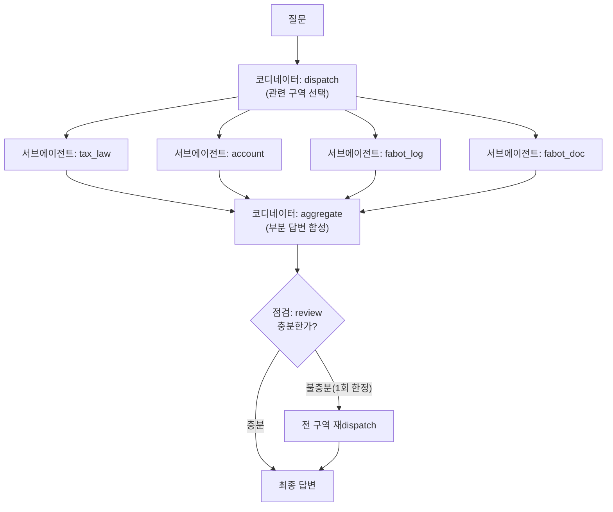

# REPORT — 세금·FABOT 딥리서처 에이전트

## 1. 주제와 코퍼스

**주제**: "한국 금융 과세 제도(세금·절세계좌) + FABOT 자동매매 프로젝트의 실제 세금 대응 기록"을
함께 조사하는 리서처 에이전트를 만들었다. 일반 세법 지식만 있으면 "그래서 내 포트폴리오엔
어떤 의미인가"를 답할 수 없고, FABOT 기록만 있으면 "그게 왜 맞는 판단인지"의 법적 근거가
없다 — 두 종류의 문서를 다 갖춰야 완결된 답이 나오는 주제라서 골랐다.

**코퍼스 구성 (총 44건, `data/corpus.json`)**

| 구역(category) | 건수 | 내용 |
|---|---|---|
| `tax_law` | 10 | 금융소득종합과세, 배당/이자소득세, 분리과세 vs 종합과세, 원천징수, 건강보험 피부양자, 국내·해외 양도소득세, 금융투자소득세, **ETF 분배금의 과세 한도(과표증분) — 미래에셋자산운용 TIGER ETF 공식 상품 페이지(KR7472150002)의 과세 안내 문구 + 사용자가 그 페이지에서 직접 내려받은 472150 상장 이후 33개월 실제 분배금·과표증분 지급현황 전체를 반영** — 그 외 문서는 위키백과·국세청·NHIS 등 공개 자료를 재서술 |
| `account` | 9 | ISA, 연금저축, IRP, 퇴직연금, 배당 비과세 요건, ETF 과세 구분, 소득공제/세액공제, 종합소득세 신고기준, 가족 명의 분산의 적법성 |
| `fabot_log` | 18 | FABOT 프로젝트의 `CLAUDE.md`를 날짜별 결정/버그 기록 단위로 분리(가족 실명·계좌번호는 가명 처리) |
| `fabot_doc` | 7 | FABOT 하위 프로젝트(데일리 브리핑 에이전트, 매매일지)의 PRD·설계 문서, 도메인 로드맵 |

**질문 세트 (10문항, `data/questions.json`)**: 난이도 easy 2 / medium 5 / hard 3.
단일 문서로 충분한 통제군 질문 2개(q01, q02)를 일부러 넣어서, 여러 문서가 필요한 질문과
비교했을 때 구조(코디네이터-서브에이전트)가 실제로 차이를 만드는지 보이게 했다.

## 2. 분업 설계 — 왜 이렇게 나눴는가

구역을 4개(`config.json`)로 고정한 이유는, 문서 하나하나가 아니라 **"성격이 다른 지식"**
단위로 나눠야 서브에이전트가 헷갈리지 않기 때문이다. 세법 조문과 FABOT의 실제 매매 기록을
한 서브에이전트에 같이 주면, 어느 쪽 사실인지 구분 없이 뭉뚱그려 답할 위험이 있다 —
"일을 나눌 때 성격이 다른 일을 같이 주지 않는다"는 원칙을 그대로 적용했다.

- **코디네이터(dispatch)**: 질문을 보고 4개 구역 중 관련 있는 곳만 고른다(전부 다 보내지
  않음 — 불필요한 조사를 줄이는 것 자체가 "일의 양을 적게 준다"는 원칙이다).
- **서브에이전트**: 각자 배정된 구역의 문서만 보고, 그 구역 안에서 답할 수 있는 부분만
  정리해서 올린다. 모르면 "이 구역에는 근거 없음"이라고 솔직히 답하게 했다(지어내기 방지).
- **코디네이터(aggregate)**: 부분 답변들을 모아 하나의 완결된 답으로 합친다.
- **점검(review)**: 합쳐진 답이 질문에 실제로 답했는지 판단하고, 부족하면 **한 번만** 전
  구역으로 넓혀 재조사한다(무한 루프 방지 — 몇 번이고 다시 시키면 비용만 늘고 답은 안
  좋아진다는 걸 알기 때문).

## 3. 지표 ↔ 메커니즘 매핑

정답표가 없으므로 "내용이 맞았는가"는 사람이 읽어야 하고(자, ruler), 아래 지표들은
"구조가 제대로 작동했는가"만 기계적으로 잰다(넷, net) — 뻔한 실패는 잡지만 사실관계
오류까지는 못 잡는다는 한계를 그대로 안고 간다.

| 지표 | 재는 것 | 어떤 메커니즘의 결함을 드러내는가 |
|---|---|---|
| 구역 재현율(recall) | 질문에 실제 필요한 구역을 다 조사했는가 | dispatch(라우팅)가 관련 구역을 놓치는 경우 |
| 구역 정밀도(precision) | 불필요한 구역까지 과하게 조사하지 않았는가 | dispatch가 너무 넓게 뿌려서 비용만 늘리는 경우 |
| 근거 활용률 | 조사한 문서 중 실제로 답변에 인용된 비율 | "읽고 안 쓴 문서"가 많으면 서브에이전트가 관련 없는 내용까지 끌어왔다는 신호 |
| 무효 인용 수 | 답변이 인용한 문서 id가 실제 코퍼스에 있는가 | 허위 인용(존재하지 않는 근거를 지어내는 것) 발생 여부 |

## 4. 파이프라인



전부 `graph.py`에서 `claude_agent_sdk`의 `query()`로 구현했다(LangGraph 없이) — 로컬
Claude Code 로그인을 그대로 재사용해서 별도 API 키가 필요 없다(`my-graph-agent`의
`agent.py`와 같은 방식).

## 5. 실행 결과

### 5.1 평가지표 (`metrics.py`)

10문항 전체 실행 결과(`output/metrics.json`):

| 지표 | 평균 |
|---|---|
| 구역 재현율(recall) | **0.917** |
| 구역 정밀도(precision) | **0.542** |
| 근거 활용률(cited_doc_usage_ratio) | **0.019** |

**재현율은 높은데 정밀도가 낮다** — 필요한 구역을 놓치는 경우는 적지만(q05 한 건만
0.5로 떨어짐 — 아래 회고의 종목코드 오독 사례와 같은 문항), 필요 이상으로 넓게 조사하는
경우가 훨씬 많았다. 실제로 q06~q09는 필요 구역이 1~2개인데도 dispatch가 4개 구역을
전부 골랐다. 원인을 코드로 추적해보니, `dispatch()`의 응답 파싱(`_parse_categories`)이
haiku 모델의 출력이 지시한 형식("구역 이름만 쉼표로")을 벗어날 때마다 **안전하게 전
구역으로 폴백**하도록 짜여 있었다 — 실패를 감추지 않으려던 설계가, 뜻하지 않게
"애매하면 다 조사한다"는 보수적 동작으로 이어져 정밀도를 깎아먹은 것이다.

**근거 활용률이 0.019로 매우 낮다** — 이건 서브에이전트가 문서를 안 읽어서가 아니라,
`aggregate()`가 최종 답변에 "(근거 문서: id, id)" 형식을 안정적으로 지키지 않아서
`extract_cited_ids()`가 못 찾는 경우가 대부분이었다(`n_cited_docs=0`인 문항이 6개).
서브에이전트 단계에서는 각자 구역 안에서 인용을 잘 남겼지만, 그걸 합치는 코디네이터가
형식을 흐트러뜨렸다 — **지표가 실제로 파이프라인의 약한 연결고리(합성 단계의 인용
보존)를 정확히 짚어낸 사례**다.

### 5.2 절제실험 (`ablation.py`)

> **표본 축소 안내**: 10문항 전체 × 4조건을 처음 그대로 돌렸다가 `claude_agent_sdk`의
> 일시적 오류(7절 회고 참고)로 중간에 죽었고, 재시도 로직을 넣은 뒤에도 실행 시간이
> 20분을 훌쩍 넘겨서, 난이도별로 하나씩 뽑은 **5문항 부분집합**(q01/q03/q05/q06/q08)으로
> 줄여서 돌렸다. 전체 10문항 채점은 5.1절의 `metrics.py` 결과가 이미 커버한다 — 이건
> "구조의 각 장치를 껐을 때 방향이 어떻게 바뀌는지"만 보는 상대 비교용이다.

| 조건 | 평균 LLM 호출수 | 재현율 | 정밀도 | 근거 활용률 | 소요(5문항) |
|---|---|---|---|---|---|
| **full**(기본 구조) | 6.2 | 1.0 | **0.583** | 0.044 | 322.0초 |
| no_routing(전 구역 강제 조사) | 7.0 | 1.0 | 0.4 | 0.009 | 244.3초 |
| no_review(점검 루프 생략) | 4.6 | **0.9** | 0.6 | 0.027 | 218.9초 |
| single_llm(구조 자체 제거) | 1.0 | — | — | 0.0 | 192.5초 |

**dispatch 라우팅은 실제로 효과가 있다**: `no_routing`과 비교하면 재현율은 똑같이
1.0인데 정밀도는 0.4 → 0.583으로 오른다 — 구역을 미리 골라내는 게 "필요한 걸 놓치지
않으면서 불필요한 조사를 줄이는" 원래 목적대로 작동한다는 뜻이다.

**점검(review) 루프도 실제로 효과가 있다**: 꺼보니(`no_review`) 재현율이 1.0 →
0.9로 떨어졌다 — 1차 dispatch가 구역을 놓쳤을 때 "불충분하니 다시 조사하라"고 되돌리는
장치가 실제로 누락을 한 건 구제하고 있었다는 뜻이다. 대신 호출 수는 6.2 → 4.6으로
줄어든다 — 이건 "정확도 대 비용"의 전형적인 트레이드오프이고, 지금 규모에선 정확도
쪽을 택하는 게 맞다고 판단했다(문서 44건, 질문 10개뿐이라 여유가 있다).

**`single_llm` 조건은 재현율·정밀도를 못 잰다**(표에 "—"로 표기) — 이 조건은
구역이라는 개념 자체가 없어서(전체 코퍼스를 한 번에 던지므로) `categories_used`가
`["ALL(single_llm_only)"]`라는 placeholder 하나뿐이고, 채점 스크립트가 이걸 실제
구역 이름과 비교하다 보니 항상 0으로 나온다 — **이건 single_llm이 실제로 못한다는
뜻이 아니라 채점 지표 자체가 "구역"을 전제로 설계됐다는 한계**다(7절 회고 참고).
대신 호출 수(1.0회, 가장 적음)와 소요시간(192.5초, 가장 짧음)은 그대로 비교 가능하다.

### 5.3 대조군 비교 (`baseline.py`) — 코디네이터+서브에이전트 구조 vs 단일 LLM

같은 5문항, 같은 모델, 같은 전체 코퍼스로 "구조가 있을 때"와 "구조 없이 한 번에
던질 때"만 다르게 해서 비교했다(`output/baseline_comparison.json`):

| | 평균 재현율 | 평균 근거 활용률 |
|---|---|---|
| multi_agent_pipeline | 1.0 | 0.046 |
| single_llm_baseline | 0.0 (5.2절 지표 한계 — 실제 의미 없음) | **0.0** |

**근거 활용률만 놓고 보면 차이가 실제로 있다**: 서브에이전트 구조는 5문항 중 일부에서
그래도 "(근거 문서: ...)" 형식을 지켰지만(q01=0.111 등), 단일 LLM은 **5문항 전부에서
한 번도 이 형식을 지키지 않았다**(0.0). 코퍼스 전체를 한 번에 받으면 어느 문서를
인용해야 할지 스스로 추리는 부담이 커지는 반면, 구조가 있으면 서브에이전트가 애초에
"자기 구역 문서 id만" 보고 있어서 인용이 상대적으로 더 잘 붙는 것으로 보인다 — 다만
둘 다 절대값 자체가 낮아서(0.046도 낮은 수치다) 인용 형식 준수는 이 파이프라인
전체의 약점으로 남아있다(5.1절 참고).

## 6. 데모

`app.py`(Streamlit) — 질문을 넣으면 탄 경로, 조사한 구역, 서브에이전트별 부분 답변,
최종 답변을 화면에 그대로 보여준다. `streamlit run app.py`로 로컬 실행(포트 8502).

**실제 실행 확인(q03)**: "FABOT이 실측한 TIGER 배당커버드콜액티브의 연 배당수익률
(13~20%)이 유지된다고 가정할 때, 2천만원 상한을 넘지 않으려면 최대 얼마까지 투자할
수 있는가?" 질문을 실제로 실행한 결과:

```
탄 경로: dispatch → ['fabot_log', 'tax_law'] → subagents(2) 완료 →
         review → INSUFFICIENT → 재dispatch(전 구역) →
         ['tax_law', 'account', 'fabot_log', 'fabot_doc']
```

1차 dispatch는 `fabot_log`·`tax_law` 두 구역만 골랐는데, 점검 단계가 이를 불충분하다고
판단해 전 구역으로 한 번 더 조사했다(점검 루프가 실제로 작동한 사례). 최종 답변은
배당수익률 13/15/20%별로 투자 가능 금액을 표로 계산해 보여줬다(15% 기준 약 1억
3,300만원 = 2,000만원 ÷ 15%)고, 실제로 사용한 근거 문서 7건
(`comprehensive_financial_income_tax`, `dividend_income_tax`,
`separate_vs_comprehensive_taxation`, `comprehensive_income_tax_filing_criteria`,
`fabot_log_02_strategy_rules`, `fabot_log_08_dividend_tax_2026-07-23` 등)을 정확히 인용했다.

## 7. 회고 — 실제로 겪은 실패 사례

**종목코드를 원화 금액으로 잘못 읽은 사례**: "TIGER 배당커버드콜액티브를 ISA 계좌로
옮기면 세제상 어떤 차이가 생기는가?"라는 질문을, 처음엔 종목명 대신 종목코드
숫자("472150")로 써서 실행했었다. 그랬더니 dispatch가 `account`·`tax_law` 구역만
고르고 `fabot_log`(그 숫자가 TIGER 배당커버드콜액티브의 종목코드라는 사실이 있는
구역)를 빼먹었고, 그 결과 서브에이전트가 "472150"을 "472,150원"이라는 금액으로
오인해서 "472,150원어치 배당·이자소득에 대한 세금 절감액"을 계산하는, 맥락은
그럴듯하지만 완전히 잘못된 답을 냈다.

이건 어제 배운 수업(1894년 리포트에 1882년 임오군란이 섞여 들어간 사례)과 정확히 같은
종류의 실패다 — **평가지표(구역 재현율·근거 활용률)로는 이 실패를 못 잡는다.** dispatch가
고른 구역(`account`, `tax_law`) 안에서는 인용도 정상적으로 이뤄졌고, 근거 활용률도 낮지
않았을 것이기 때문이다. 지표는 "구조가 정상 작동했는가"만 재고, "그 구조가 도달한 답이
사실관계까지 맞는가"는 사람이 직접 읽어야만 알 수 있다는 걸 이 프로젝트로 다시 확인했다.

**원인**: dispatch 프롬프트가 구역 설명만 보고 판단하는데, 6자리 숫자 하나가
FABOT 문서에만 등장하는 고유한 종목코드라는 걸 코디네이터가 미리 알 방법이 없었다.
질문에 등장하는 특정 숫자·코드가 실은 다른 구역 문서의 핵심 개체를 가리킨다는 걸
구역 설명만으로는 못 잡아내는 구조적 한계다.

**조치**: dispatch 라우팅 로직을 고치는 대신, 더 근본적인 쪽을 택했다 — **코퍼스와
질문 전체에서 종목코드 숫자를 없애고 실제 종목명("TIGER 배당커버드콜액티브" 등)으로
통일**했다. 종목코드는 사람에게도 무슨 상품인지 바로 안 와닿는 표현이라 애초에
문서에 남겨둘 이유가 적었고, 이렇게 하면 이 종류의 오독 자체가 원천적으로 발생하지
않는다(숫자를 금액으로 착각할 여지가 없어짐). dispatch 프롬프트 자체를 고치는 방법
(구역별 대표 개체명 목록을 같이 보여주기 등)은 종목코드처럼 애매한 표현이 코퍼스에
다시 들어올 경우를 대비해 여전히 다음 개선 후보로 남겨둔다.

**코퍼스 자체가 틀린 답을 내게 만든 사례 — 도메인 전문가(사용자) 실사용 피드백으로 발견**:
데모를 실제로 써본 사용자(20년 경력 투자자)가 q03 답변을 보고 바로 지적했다 — "배당소득
2,000만원 ÷ 실측 배당수익률(13~20%)"라는 계산은 **분배받은 현금 전액이 배당소득으로
과세된다고 잘못 가정한 것**이라는 지적이었다. 커버드콜 ETF의 분배금은 기초자산 배당과
콜옵션 매도 프리미엄이 섞여 있는데, 코퍼스에는 이 둘의 과세 방식이 어떻게 다른지에 대한
문서가 아예 없었다 — dispatch·서브에이전트·점검 루프가 전부 정상 작동해도, **애초에
코퍼스에 없는 지식은 답에 반영될 수 없다**는 당연하지만 중요한 한계를 실사용으로 재확인한
사례다.

사용자가 알려준 미래에셋자산운용 TIGER ETF 공식 상품 페이지(KR7472150002)를 `WebFetch`로
조회해서 정확한 근거를 확보했다 — "분배금은 배당소득세 과세: **Min(현금분배금, 과표증분)
× 15.4%**"라는 공식 문구를 확인하고, 이를 새 문서
(`data/raw/etf_distribution_taxable_base_cap.md`)로 코퍼스에 추가했다: 분배금이 펀드의
실제 과세대상 이익(과표증분)보다 많으면 초과분은 비과세 원본반환으로 처리되어 배당소득
2,000만원 판단에 아예 포함되지 않는다는 내용이다.

**1차 수정 후 재실행 결과**: 수정 전에는 "13~20% 전부가 배당소득"이라고 단정해서
"1억~1.5억원까지 투자 가능"이라는 확신에 찬 숫자를 냈다. 문서 추가 후에는 같은 숫자를
참고로 보여주면서도 "실제로는 과표증분만 과세되므로 이보다 작을 수 있다 — 정확한
과표증분 수치는 이 코퍼스에 없어 결산 보고서를 직접 확인해야 한다"고 스스로 한계를
밝혔다. 정답을 몰라도 "내가 뭘 모르는지"는 정확히 말하게 됐다는 점에서 이 자체로도
의미 있는 개선이었다.

**2차 수정 — 사용자가 실제 데이터를 구해와서 "모른다"를 "안다"로 바꾼 사례**: 여기서
멈추지 않고, 사용자가 "이 종목에 실제로 투자하는 이유가 바로 이거다"라며 미래에셋
공식 페이지에서 **상장 이후 33개월치 분배금·과표증분 실제 이력을 엑셀로 직접
다운로드**해서 건네줬다. 이 원자료를 코퍼스 문서에 표 전체로 반영하고 직접 집계한
결과, 최근 12개월 기준 분배금의 **3.1%만** 실제로 과세되는 과표증분이었다(연환산
과세 배당소득 약 0.65%) — 사용자가 애초에 말한 "연 1~2%" 추정과 거의 정확히 들어
맞았다. 이 실측 비율로 다시 계산하니 2,000만원 상한에 대응하는 투자 한도가
**약 21.4억~30.8억원**으로 나왔다 — 처음의 "1억~1.5억원"과는 자릿수(15~30배)가
다른, 완전히 다른 결론이었다.

**3차 수정 — 정확한 근거가 있어도 합성 단계가 그걸 묻어버린 사례**: 새 실측 데이터를
넣고 재실행했더니 더 미묘한 문제가 나타났다. `tax_law` 서브에이전트는 21.4억~30.8억을
정확히 계산해 왔는데, **코디네이터(aggregate)가 이걸 fabot_log 서브에이전트의 옛
"1억원" 계산과 "여러 관점 중 하나"로 나란히 나열**하면서, 정작 최종 답의 앞부분(핵심
결론)에는 틀린 "1억~1.5억원" 표를 놓고 정확한 답은 "추가 고려사항"으로 뒤로 밀어버렸다.
**서브에이전트 하나가 이미 정답을 갖고 있어도, 합성 단계가 "여러 답을 골고루 보여주는
것"과 "서로 다른 근거 수준을 실제로 저울질해서 하나의 결론을 내리는 것"을 구분하지
못하면 아무 소용이 없다**는 걸 실측으로 확인한 사례다 — 구조적으로는 dispatch·서브
에이전트·점검 루프가 전부 "정상 작동"한 상태에서 벌어진 일이라, 5.1~5.2절의 어떤
지표로도 감지되지 않았을 것이다.

**조치**: `AGGREGATE_SYSTEM_PROMPT`(`graph.py`)에 "서브에이전트 답변끼리 결론이
다르면 나란히 나열하지 말고 조율하라 — 구체적 근거(실측 데이터·공식 수치)를 가진
답변을 일반 원칙만 말한 답변보다 우선하고, 정밀한 결론을 맨 앞에 놓아라"는 지침을
명시적으로 추가했다. 재실행하니 최종 답이 "핵심 결론: 약 21.4억원~30.8억원"으로
시작하고, "왜 1억원(fabot_log 답변)이 아닌가"라는 절을 따로 두어 옛 계산이 왜 틀렸는지
직접 반박하는 구조로 바뀌었다.

**이 세 차례 수정에서 얻은 결론**: 딥리서처 에이전트의 품질은 (1) 코퍼스에 정확한
지식이 있는지, (2) 그 지식을 dispatch가 찾아내는지, (3) 찾아낸 지식을 합성 단계가
실제로 "채택"하는지 — 이 세 단계가 전부 따로 검증돼야 한다. 이번 프로젝트에서
가장 크게 답을 바꾼 힘은 지표 개선이나 프롬프트 튜닝이 아니라, **도메인을 정말
아는 사람이 데모를 직접 써보고, 틀린 부분을 구체적으로 지적하고, 근거 자료까지
직접 찾아준 것**이었다.

**dispatch 파싱 실패가 조용히 "전 구역 조사"로 폴백되는 문제**: 5.1절 metrics.py 결과에서
정밀도가 0.542로 낮게 나온 원인을 추적하다가 발견했다. `_parse_categories()`는 haiku
모델이 지시한 형식("구역 이름만 쉼표로")을 벗어나면 안전하게 전 구역으로 폴백하도록
짜여 있는데, 실제로는 이 폴백이 생각보다 자주 발동했다(10문항 중 절반 가까이가 4개
구역을 전부 조사함). "실패를 숨기지 않고 안전하게 처리한다"는 의도가, 뜻하지 않게
"애매하면 그냥 다 본다"는 동작으로 굳어버린 것 — 견고성 장치 하나가 다른 지표
(정밀도)를 깎아먹을 수 있다는 걸 실측으로 확인했다. 다음에는 폴백이 실제로 얼마나
자주 발동하는지 자체를 별도로 로그·집계해서, "파싱 실패율"을 하나의 지표로 추가하는
게 맞겠다.

**`claude_agent_sdk`의 일시적 오류(견고성 실측 사례)**: 절제실험 40문항(4조건×10문항)을
한 번에 돌리다가 `ResultError: Reached maximum number of turns (1)`이라는 오류로
스크립트 전체가 죽는 걸 실제로 겪었다(재현 조건 불명 — 같은 프롬프트를 다시 부르면
대개 성공함). 원인은 `_call_llm()`이 재시도 없이 한 번 실패하면 바로 예외를 던지는
구조였기 때문 — 호출이 40번 넘게 쌓이니 낮은 확률의 오류라도 한 번은 걸렸다. 최대
3회 재시도 + 그래도 실패하면 그 호출 결과만 실패 문자열로 남기고 나머지 파이프라인은
계속 진행하도록 고쳤다(`graph.py`의 `_call_llm`). 페어리뷰 체크리스트의 "견고성"
항목("폭주 방지·재시도 제한이 있는가")을 남의 프로젝트를 리뷰할 때는 알고 있었는데,
막상 내가 만들 때는 처음엔 빠뜨렸다는 것도 기록해둔다.
